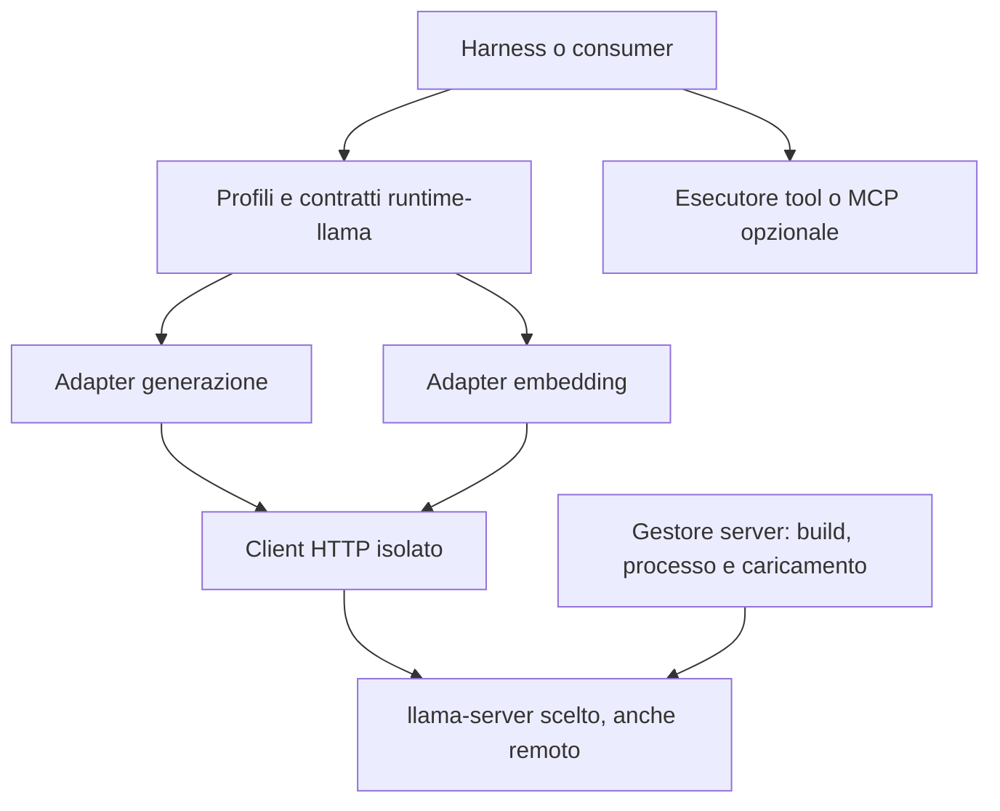

# Architettura della libreria

Il package Python `runtime-llama` separa i contratti per i consumer dal
trasporto HTTP e dall'inferenza eseguita da llama-server. La base funzionale è
`lmstudio-agent-runtime`; la base del client è `LlamaCppClient` di
llamatelemetry, isolato dal package initializer e dal bootstrap CUDA.

La libreria comprende scheduler embedding, prefissi per modello, diagnostica
per invocazione e discovery delle repliche per identità del contenuto pubblicata
dal runtime. La versione `0.5.0` aggiunge una proiezione pubblica read-only del
catalogo e dei modelli provati caricati, sopra lo stesso client HTTP.
Generazione, embedding e scheduler mantengono le API esistenti. I test non certificano
compatibilità universale con ogni modello/template; l'integrazione dei consumer
resta una fase distinta.

## Responsabilità

Il gestore del server possiede build, compilazione, binario, processo,
caricamento e risorse. Il server può essere locale o remoto.
Il client invia le richieste a quel server e non introduce un runtime locale.

L'auto-load gestito dal server scelto è consentito: il
client non impone `autoload=false` e non usa un altro backend per caricare.
I metodi `load()` degli adapter controllano la disponibilità; non costituiscono
un'API di controllo del processo o di caricamento amministrativo.

Il consumer possiede prompt, policy dell'agente, esecuzione dei tool e
continuazione della chat.
La scelta Python del client non vincola i linguaggi del resto del harness e
non promette un aumento dei tok/s dell'inferenza nativa.

## Moduli e mapping

| Modulo | Responsabilità |
| --- | --- |
| `configuration.py` | Profili immutabili distinti per server, ruolo e generazione; prefissi embedding per modello; identità fisica indipendente da sampling, credenziali e prefissi |
| `contracts.py`, `usage.py`, `errors.py`, `runaway.py` | Accumulazione del testo, reasoning, budget visibile, interruzione, esiti e diagnostica della baseline adattati |
| `client.py` | HTTP `requests`, parsing JSON/SSE rigoroso, limite JSON opzionale, policy ambientale esplicita, cleanup, cancellazione, errori classificati e API raw |
| `model_discovery.py` | Catalogo pubblico tipizzato e bounded, soli GET catalogo/root props, stati e capacità sconosciuti espliciti, identità e metadati con fonte |
| `adapters/llama.py` | `/v1/chat/completions`, storia completa, sampling, reasoning/template, schema, tool delta e usage |
| `adapters/embedding.py` | Preparazione query/document/raw, `/v1/embeddings`, `/tokenize`, `/props`, batching, limiti, ordine e integrità numerica |
| `embedding_scheduler.py` | Ammissione condivisa, coda limitata, routing per alias e tetti globali/per replica |
| `replica_discovery.py` | Selezione del modello logico e repliche loaded dai tag Noxi di identità contenuto e compatibilità semantica |
| `diagnostics.py` | Cattura thinking opzionale e limitata, correlazione per chiamata e sink finale |
| `factory.py`, `embedding_factory.py` | Costruzione senza richieste HTTP o avvio del server |
| `mcp.py` | Contratti dati MCP riusati; nessun trasporto o esecutore |

`LlamaCppClient.request()` espone anche le API raw, conservando proprietà extra
e valori mancanti. Gli helper includono completion nativa, chat, embedding,
tokenizer/detokenizer, health, props e modelli. Il trasporto non applica retry o
redirect automatici; TLS è verificato per default. Le API disponibili dipendono
dalla build server, non dalla sola presenza dell'helper.

## Configurazione fisica e richiesta

`LlamaServerConfig` descrive endpoint, alias modello, contesto dichiarato e
identità runtime opzionale. Non modifica le risorse del server.
`LlamaRoleConfig` descrive il ruolo del consumer e i suoi tetti logici.
`LlamaGenerationConfig` descrive sampling, output, timeout e opzioni template.

`num_predict` è mappato su `max_tokens`; `request_options` consente override di
sampling ed estensioni per chiamata. Campi gestiti come modello, messaggi,
streaming, budget e configurazione fisica non possono essere sovrascritti da
questo escape hatch. `num_ctx` è un tetto logico: non rialloca KV o contesto.
Valori `num_ctx` superiori al contesto dichiarato/osservato vengono rifiutati.
La libreria non tokenizza preventivamente la cronologia chat: conteggio e
assemblaggio del contesto spettano al consumer/server.

`reasoning=auto` lascia la policy al server. Le altre policy mappano
`chat_template_kwargs.enable_thinking` e, quando pertinente, `reasoning_effort`.
Il loro effetto deve essere qualificato sul modello/template. Lo schema viene
inoltrato in `response_format`; non viene eseguita validazione JSON Schema
locale della risposta.

## Streaming, tool e interruzione

Generazione bloccante e streaming usano lo stesso percorso SSE. I messaggi dict
conservano campi aggiuntivi, tool call e correlazione dei risultati. I delta tool
sono assemblati per indice e mantengono ID, nome e argomenti JSON in forma
originale. L'adapter non esegue il tool; il harness prosegue la conversazione.

I terminali e l'usage possono arrivare in eventi distinti. EOF senza terminale,
JSON/UTF-8 invalidi e campi strutturati malformati causano errori espliciti.
Usage assente resta `None`; eventuali valori derivati sono marcati.

Il client usa un pump di lettura limitato per rilevare cancellazione anche
mentre la risposta tarda. Il timeout limita connessione/lettura HTTP e attesa di un nuovo evento JSON;
i soli heartbeat SSE non lo rinnovano. Non è una deadline totale. Chiusura anticipata, cancellazione e limiti visibili
chiudono lo stream client; l'arresto effettivo dell'inferenza remota richiede
una prova live. Chi abbandona un generatore prima del terminale deve chiuderlo.
La libreria non persiste contenuti. La cattura thinking esplicitamente abilitata
consegna al consumer una copia limitata del reasoning; il logging ordinario
conserva solo conteggi. Prompt e header non vengono raccolti.

## Embedding

`AdapterProfile.embedding_prefixes` contiene una coppia immutabile
`EmbeddingPrefixes(query, document)`, vuota per default. Il profilo del modello
possiede la preparazione dipendente dal training; il consumer indica query o
documento attraverso i metodi esistenti o `input_type`. `raw` permette input
già preparati. La libreria concatena stringhe letterali, senza dedurre il task
dal nome dell'alias o interpretare template.

Il testo completo viene preparato una sola volta nello stato locale della
chiamata, prima di scheduler e tokenizzazione. Query e documenti concorrenti
non modificano un task condiviso nell'adapter; tutte le repliche ereditano
lo stesso formato e lo split adattivo non riapplica il prefisso. I prefissi
rientrano nei limiti input e nel budget di packing. La configurazione non
modifica l'identità fisica o il caricamento del server; il consumer deve
conservare la coerenza semantica con gli indici già costruiti.

La tokenizzazione avviene sul server con aggiunta/parsing dei token speciali.
I limiti effettivi combinano i tetti configurati e il contesto osservato, quando
noti. Il batch conserva l'ordine, valida indici e vettori finiti e pubblica una
nuova dimensione osservata soltanto dopo la validazione completa della chiamata.

Soltanto l'errore HTTP 400 strutturato `exceed_context_size_error` consente lo
split adattivo del batch; altri errori propagano. Un singolo input fuori limite
fallisce senza troncamento implicito. Il recupero della dimensione del batch è
progressivo dopo successi; non modifica il modello o le istanze del server.

Uno scheduler per adapter limita lavori attivi e accodati, anche fra chiamanti
concorrenti. Ogni lavoro mantiene alias e posto fino alla pulizia HTTP;
tokenizzazione, packing e split rispettano i limiti della replica scelta.
`close()` drena i lavori e le risorse possedute. Il default resta sequenziale.
Il [contratto di integrazione](INTEGRATION.md) descrive configurazioni, ownership,
readiness e diagnostica; [CONCURRENCY-AND-DIAGNOSTICS.md](CONCURRENCY-AND-DIAGNOSTICS.md)
conserva la motivazione architetturale dell'incremento.

L'opt-in `embedding_replica_discovery` aggiunge uno snapshot delle istanze
loaded, selezionate da nome logico, alias ancora o digest. L'identità dei byte
e la compatibilità semantica sono dichiarate da Noxi nei tag nativi; la
libreria non le deduce dal path. Il pool automatico applica una richiesta
attiva per replica e gestisce ID operativi, refresh, pinning e cambi topologia
senza trasferire questi dettagli al consumer. Il contratto completo è in
[AUTOMATIC-EMBEDDING-REPLICAS.md](AUTOMATIC-EMBEDDING-REPLICAS.md).

## Verifica e limiti

I [requisiti funzionali](REQUIREMENTS.md) collegano contratti e test locali.
Una prova live deve identificare build, modello, template, configurazione di
caricamento e consumer, includendo tool, reasoning, schema, embedding, timeout
e arresto della generazione remota. La pubblicazione `0.5.0` non dichiara una
nuova qualifica live o acceptance del consumer.

Riferimenti versionati del mapping:
[server v0.6.0](https://github.com/ggml-org/llama.cpp/blob/v0.6.0/tools/server/README.md),
[function calling v0.6.0](https://github.com/ggml-org/llama.cpp/blob/v0.6.0/docs/function-calling.md).
Provenienza e differenze dalla baseline sono descritte in
[PROVENANCE.md](PROVENANCE.md) e [FUNCTIONAL-PARITY.md](FUNCTIONAL-PARITY.md).
