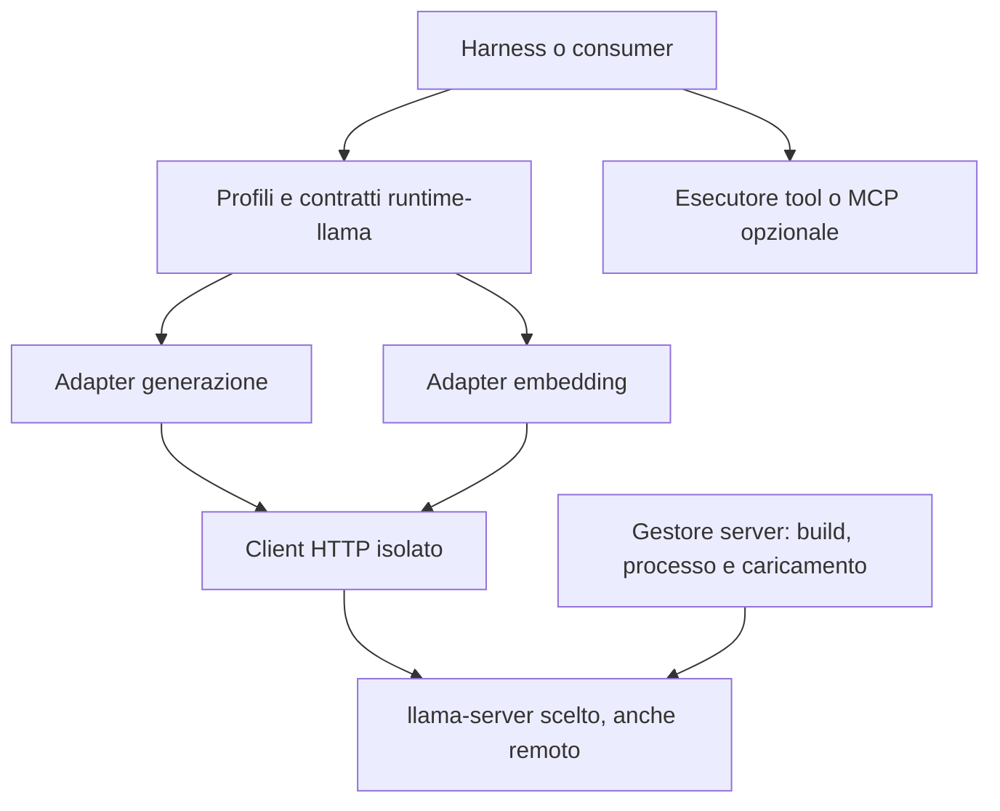

# Architettura della libreria

Il package Python `runtime-llama` separa i contratti per i consumer dal
trasporto HTTP e dall'inferenza eseguita da llama-server. La base funzionale è
`lmstudio-agent-runtime`; la base del client è `LlamaCppClient` di
llamatelemetry, isolato dal package initializer e dal bootstrap CUDA.

La libreria comprende scheduler embedding, prefissi per modello, diagnostica
per invocazione e discovery delle repliche per identità del contenuto pubblicata
dal runtime. La versione `0.5.0` aggiunge una proiezione pubblica read-only del
catalogo e dei modelli provati caricati, sopra lo stesso client HTTP.
Generazione, embedding e scheduler mantengono le API esistenti. I test non certificano
compatibilità universale con ogni modello/template; l'integrazione dei consumer
resta una fase distinta.

La versione `0.10.2` affida il coordinamento embedding a un motore persistente
dell'adapter. Preparazione esatta e HTTP avanzano in
pool di thread limitati; ogni replica verificata possiede una coda di record
pronti. Un solo scheduler seleziona il batch quando dispone della capacità
globale e locale, includendo il lavoro arrivato durante l'inferenza precedente.
Le API sincrona e asincrona attendono i risultati dello stesso motore; le
finestre restano confini di consegna ordinata. Record compatibili da finestre o
chiamate diverse possono condividere un POST, mantenendo indici, risultati e
cancellazione per proprietario. La cancellazione di uno non interrompe gli
altri: il suo completamento attende il drain effettivo del trasporto condiviso,
che ha una deadline finita fissata al massimo delle deadline iniziali. Il
[progetto delle code persistenti](EMBEDDING-QUEUE-DESIGN.md) e il
[contratto embedding](PROGRESSIVE-EMBEDDING.md) descrivono limiti e lifecycle.

`batch_size` conserva il budget totale di testi e le quote bilanciate sulle
repliche utilizzabili, senza ridurre il target HTTP alla dimensione delle
finestre sorgente. `embedding_batch_wait_sec=0.0` riempie i batch tramite eventi
di preparazione e capacità senza richiedere un timer; il primo record pronto
non forza un POST parziale mentre altro lavoro compatibile può avanzare.
Valori positivi mantengono coalescing opzionale nello stesso
percorso. I budget configurabili di byte pendenti, token preparati e payload
completano la backpressure. Il lavoro locale non cambia gli slot del server e
la tokenizzazione remota dei testi nuovi resta necessaria.

Il credito di lookahead della preparazione e' distinto dalla vita del piano:
si libera quando non restano gruppi da preparare ne' worker di preparazione
attivi. Record pronti o in volo, crediti byte/token, risultati e ownership HTTP
restano trattenuti fino alla rispettiva consegna o al drain. Anche la lease
della finestra async resta occupata fino alla consegna o pulizia; liberare
lookahead non significa liberare la capacita' HTTP.

La versione `0.10.2` riusa osservazioni metadata coerenti durante l'ammissione,
senza ripetere il catalogo gia' letto per l'appartenenza al pool. Prima dei POST
restano verificati identita', build tokenizer e limiti correnti. Una cache LRU
dell'adapter conserva solo tuple di ID esatti completati: identita' verificata,
build, task, testo e policy di prefissi/token speciali fanno parte della chiave.
Non autorizza l'inferenza e non evita la validazione dei record pubblici.
Il pool aggiuntivo e' limitato a 1.024 entry e a
`min(8 MiB, embedding_max_pending_bytes // 4)` byte, distinti da code e risultati.
Non prevede TTL o singleflight; richieste fredde concorrenti possono ripetere
la tokenizzazione. Evizione e chiusura liberano le entry. I contatori sono
esposti nella diagnostica, senza dichiarare un tetto globale della RSS.

Il candidato locale `0.13.1.dev1`, governato da Flower `REQ-000044` /
`PACKET-000030`, separa l'ammissione iniziale dello stream automatico dal
preflight dei POST. Uno scope privato conserva osservazioni iniziali e una
generazione verificata, senza possedere riferimenti al pool durante le pause.
Ogni finestra ammessa acquisisce il proprio riferimento reale. Cataloghi
freschi che rilevano cambiamenti nell'intero gruppo di repliche revocano lo
scope; la sostituzione del pool attende il drain e soltanto una nuova ammissione
autorevole può riabilitare il riuso. Nessuno snapshot ripristina capacità
obsolete. Catalogo e proprietà freschi prima dei POST, recovery, scheduler e
quote restano quelli esistenti. Non viene anticipato il preflight mentre
la capacità dell'alias è occupata.

Il candidato successivo `0.13.1.dev2` (`REQ-000045` / `PACKET-000031`)
introduce un'identità privata di consumer per lo stream, distinta dallo scope
di ammissione e dall'ownership delle singole finestre. Il packing ruota fra
consumer indipendenti e concatena le finestre pronte dello stesso consumer
in ordine sorgente. Può riempire un POST attraverso più finestre; una coda
temporaneamente vuota non blocca le successive già pronte. Questo evita che
due finestre prefetched mantengano entrambe incompleta la propria parte sulla
replica lenta, impedendo l'ingresso di altro lavoro sulla veloce. Il turno per
alias avanza soltanto dopo dispatch effettivo. I sommari di readiness seguono
lo stesso ordine, anche nel passaggio da ID nativi a testo. Scheduler, capacità,
crediti e consegna ordinata rimangono quelli esistenti.

L'architettura adottata revisione 4 e il packet complementare
`PACKET-000019` (`REQ-000034`/`REQ-000035`, `MILE-000018`, `CHANGE-000018`)
mantengono sommari incrementali delle code pronte. Il packing usa iteratori
sul prefisso necessario alla richiesta corrente e rotazioni dei proprietari
in tempo costante; non congela un candidato persistente durante le attese.
Se un'eccezione esterna interrompe l'attesa sincrona della Future del motore,
viene ritirato soltanto quel proprietario e si attende il drain reale prima di
rilanciare l'eccezione originale, anche con interruzioni ripetute in cleanup.
Gli altri proprietari di un POST condiviso e l'adapter/client restano aperti;
valgono le deadline e i limiti di trasporto gia' descritti.

La versione `0.6.0` aggiunge il trasporto opzionale
[Tailscale/Headscale](TAILNET.md). `TailnetConfig` mantiene la configurazione
del consumer; `TailnetHelper` supervisiona un binario Go separato che espone
un proxy loopback autenticato. `_proxy.py` valida la route esplicita e il client
la applica a ogni sessione HTTP posseduta. I default e il wheel Python restano
indipendenti dall'helper: nessun avvio, login o download implicito.

Il backend è fissato a tsnet `1.104.1` e Go `1.27.1`. Dopo una verifica del
peer corrente, lo shim netstack userspace evita il fallback del dialer generico
a DNS o connessioni di inferenza del sistema. Lo shim usa un'API upstream
instabile e richiede revisione prima di cambiare pin. Il proxy mantiene TLS
end-to-end attraverso CONNECT; HTTP usa connessioni upstream nuove per evitare
replay automatici. Stop riguarda la singola richiesta, mentre shutdown chiude
e drena helper, client gestiti, discovery e tunnel. I profili costruiti dal
consumer con `proxy_url` devono essere chiusi dal loro proprietario.

## Responsabilità

Il gestore del server possiede build, compilazione, binario, processo,
caricamento e risorse. Il server può essere locale o remoto.
Il client invia le richieste a quel server e non introduce un runtime locale.

L'auto-load gestito dal server scelto è consentito: il
client non impone `autoload=false` e non usa un altro backend per caricare.
I metodi `load()` degli adapter controllano la disponibilità; non costituiscono
un'API di controllo del processo o di caricamento amministrativo.

Il consumer possiede prompt, policy dell'agente, esecuzione dei tool e
continuazione della chat.
La scelta Python del client non vincola i linguaggi del resto del harness e
non promette un aumento dei tok/s dell'inferenza nativa.

## Moduli e mapping

| Modulo | Responsabilità |
| --- | --- |
| `configuration.py` | Profili immutabili distinti per server, ruolo e generazione; prefissi embedding per modello; identità fisica indipendente da sampling, credenziali e prefissi |
| `contracts.py`, `usage.py`, `errors.py`, `runaway.py` | Accumulazione del testo, reasoning, budget visibile, interruzione, esiti e diagnostica della baseline adattati |
| `client.py` | HTTP `requests`, parsing JSON/SSE rigoroso, limite JSON opzionale, policy ambientale esplicita, cleanup, cancellazione, errori classificati e API raw |
| `_http_interrupt.py` | Hook per connessione owned della singola richiesta SSE senza idle; shutdown, detach prima del riuso e mapping locali a sessione/proxy |
| `model_discovery.py` | Catalogo pubblico tipizzato e bounded, soli GET catalogo/root props, stati e capacità sconosciuti espliciti, identità e metadati con fonte |
| `tailnet.py`, `_proxy.py` | Configurazione consumer, protocollo stdin limitato, supervisor dell'helper e route loopback esplicita per tutte le sessioni possedute |
| `helpers/tsnet` | Binario opzionale con stato dedicato, peer verificati, netstack userspace, proxy HTTP/CONNECT autenticato e teardown drenato |
| `adapters/llama.py` | `/v1/chat/completions`, storia completa, sampling, reasoning/template, schema, tool delta e usage |
| `adapters/embedding.py` | Preparazione query/document/raw, `/v1/embeddings`, `/tokenize`, `/props`, batching, limiti, ordine e integrità numerica |
| `embedding_engine.py` | Motore persistente condiviso dalle API sync/async, code per replica, preparazione concorrente, selezione dei batch al dispatch e budget delle risorse |
| `embedding_packing.py` | Viste senza copia delle code esistenti: equità fra consumer, finestre pronte in ordine per stream e sommari coerenti dei prefissi di ID nativi |
| `embedding_scheduler.py` | Ammissione condivisa, coda limitata, routing per alias e tetti globali/per replica |
| `replica_discovery.py` | Selezione del modello logico e repliche loaded dai tag Noxi di identità contenuto e compatibilità semantica |
| `diagnostics.py` | Cattura thinking opzionale e limitata, correlazione per chiamata e sink finale |
| `factory.py`, `embedding_factory.py` | Costruzione senza richieste HTTP o avvio del server |
| `mcp.py` | Contratti dati MCP riusati; nessun trasporto o esecutore |

`LlamaCppClient.request()` espone anche le API raw, conservando proprietà extra
e valori mancanti. Gli helper includono completion nativa, chat, embedding,
tokenizer/detokenizer, health, props e modelli. Il trasporto non applica retry o
redirect automatici; TLS è verificato per default. Le API disponibili dipendono
dalla build server, non dalla sola presenza dell'helper.

Il quiet timeout SSE può essere esplicitamente disabilitato con
`stream_idle_timeout_sec=None`. L'adapter eredita il budget HTTP finito del
client e invia `idle_timeout=None` separatamente. Il default resta 30 secondi;
JSON, discovery ed embedding rimangono finiti. La cancellazione interrompe il
socket owned prima di chiudere e drenare la risposta, anche durante l'attesa
degli header. I hook sono disarmati prima del riuso della sessione; nessuna
modifica globale alle classi urllib3. I limiti DNS/connect e le sessioni borrowed
sono descritti in [STREAM-TIMEOUTS.md](STREAM-TIMEOUTS.md).

## Configurazione fisica e richiesta

`LlamaServerConfig` descrive endpoint, alias modello, contesto dichiarato e
identità runtime opzionale. Non modifica le risorse del server.
`LlamaRoleConfig` descrive il ruolo del consumer e i suoi tetti logici.
`LlamaGenerationConfig` descrive sampling, output, timeout e opzioni template.

`num_predict` è mappato su `max_tokens`; `request_options` consente override di
sampling ed estensioni per chiamata. Campi gestiti come modello, messaggi,
streaming, budget e configurazione fisica non possono essere sovrascritti da
questo escape hatch. `num_ctx` è un tetto logico: non rialloca KV o contesto.
Valori `num_ctx` superiori al contesto dichiarato/osservato vengono rifiutati.
La libreria non tokenizza preventivamente la cronologia chat: conteggio e
assemblaggio del contesto spettano al consumer/server.

`reasoning=auto` lascia la policy al server. Le altre policy mappano
`chat_template_kwargs.enable_thinking` e, quando pertinente, `reasoning_effort`.
Il loro effetto deve essere qualificato sul modello/template. Lo schema viene
inoltrato in `response_format`; non viene eseguita validazione JSON Schema
locale della risposta.

## Streaming, tool e interruzione

Generazione bloccante e streaming usano lo stesso percorso SSE. I messaggi dict
conservano campi aggiuntivi, tool call e correlazione dei risultati. I delta tool
sono assemblati per indice e mantengono ID, nome e argomenti JSON in forma
originale. L'adapter non esegue il tool; il harness prosegue la conversazione.

I terminali e l'usage possono arrivare in eventi distinti. EOF senza terminale,
JSON/UTF-8 invalidi e campi strutturati malformati causano errori espliciti.
Usage assente resta `None`; eventuali valori derivati sono marcati.

Il client usa un pump di lettura limitato per rilevare cancellazione anche
mentre la risposta tarda. Il timeout limita connessione/lettura HTTP e attesa di un nuovo evento JSON;
i soli heartbeat SSE non lo rinnovano. Non è una deadline totale. Chiusura anticipata, cancellazione e limiti visibili
chiudono lo stream client; l'arresto effettivo dell'inferenza remota richiede
una prova live. Chi abbandona un generatore prima del terminale deve chiuderlo.
La libreria non persiste contenuti. La cattura thinking esplicitamente abilitata
consegna al consumer una copia limitata del reasoning; il logging ordinario
conserva solo conteggi. Prompt e header non vengono raccolti.

## Embedding

`AdapterProfile.embedding_prefixes` contiene una coppia immutabile
`EmbeddingPrefixes(query, document)`, vuota per default. Il profilo del modello
possiede la preparazione dipendente dal training; il consumer indica query o
documento attraverso i metodi esistenti o `input_type`. `raw` permette input
già preparati. La libreria concatena stringhe letterali, senza dedurre il task
dal nome dell'alias o interpretare template.

Il testo completo viene preparato una sola volta nello stato locale della
chiamata, prima di scheduler e tokenizzazione. Query e documenti concorrenti
non modificano un task condiviso nell'adapter; tutte le repliche ereditano
lo stesso formato e lo split adattivo non riapplica il prefisso. I prefissi
rientrano nei limiti input e nel budget di packing. La configurazione non
modifica l'identità fisica o il caricamento del server; il consumer deve
conservare la coerenza semantica con gli indici già costruiti.

La tokenizzazione avviene sul server con aggiunta/parsing dei token speciali.
I limiti effettivi combinano i tetti configurati e il contesto osservato, quando
noti. Il batch conserva l'ordine, valida indici e vettori finiti e pubblica una
nuova dimensione osservata soltanto dopo la validazione completa della chiamata.

Il client HTTP nativo non ripete un POST embedding fallito o ambiguo.
Per client iniettati con il contratto esplicito di recupero, soltanto l'errore
HTTP 400 strutturato `exceed_context_size_error` consente lo split adattivo;
gli altri errori propagano. Un singolo input fuori limite fallisce senza
troncamento implicito. Il recupero della dimensione del batch è progressivo
dopo successi; non modifica il modello o le istanze del server.

Uno scheduler per adapter limita lavori attivi e accodati, anche fra chiamanti
concorrenti. Ogni lavoro mantiene alias e posto fino alla pulizia HTTP;
tokenizzazione, packing e split rispettano i limiti della replica scelta.
`close()` drena i lavori e le risorse possedute. Il default resta sequenziale.
Il [contratto di integrazione](INTEGRATION.md) descrive configurazioni, ownership,
readiness e diagnostica; [CONCURRENCY-AND-DIAGNOSTICS.md](CONCURRENCY-AND-DIAGNOSTICS.md)
conserva la motivazione architetturale dell'incremento.

L'opt-in `embedding_replica_discovery` aggiunge uno snapshot delle istanze
loaded, selezionate da nome logico, alias ancora o digest. L'identità dei byte
e la compatibilità semantica sono dichiarate da Noxi nei tag nativi; la
libreria non le deduce dal path. Il pool automatico limita le richieste attive
per replica agli slot positivi osservati e al limite globale configurato;
capacita' sconosciuta implica una sola richiesta. Gestisce ID operativi,
refresh, pinning e cambi topologia
senza trasferire questi dettagli al consumer. Il contratto completo è in
[AUTOMATIC-EMBEDDING-REPLICAS.md](AUTOMATIC-EMBEDDING-REPLICAS.md).

## Verifica e limiti

I [requisiti funzionali](REQUIREMENTS.md) collegano contratti e test locali.
Una prova live deve identificare build, modello, template, configurazione di
caricamento e consumer, includendo tool, reasoning, schema, embedding, timeout
e arresto della generazione remota. La pubblicazione `0.5.0` non dichiara una
nuova qualifica live o acceptance del consumer.

Riferimenti versionati del mapping:
[server v0.6.0](https://github.com/ggml-org/llama.cpp/blob/v0.6.0/tools/server/README.md),
[function calling v0.6.0](https://github.com/ggml-org/llama.cpp/blob/v0.6.0/docs/function-calling.md).
Provenienza e differenze dalla baseline sono descritte in
[PROVENANCE.md](PROVENANCE.md) e [FUNCTIONAL-PARITY.md](FUNCTIONAL-PARITY.md).

## Indagine HTTP nativo e throughput embedding — 20 ottobre 2026

Questa sezione descrive una diagnosi e un progetto di ottimizzazione della
baseline `8ffb7ca` (`0.6.0`). Le proposte sotto non sono configurazioni già
disponibili né una nuova qualifica prestazionale. Requisiti, piano, esiti e
continuazioni restano nel progetto Flower `llama-runtime`.

### Supporto nativo e indipendenza dalla patch

Keep-alive è una funzionalità nativa di cpp-httplib. Il suo contratto distingue
la fine normale del body, `sink.done()`, dalla cancellazione indicata da un
ritorno `false` del content provider. La patch storica corregge questa
distinzione nel callback del server; non introduce il batching o la concorrenza.
Vedere il [contratto upstream](https://github.com/yhirose/cpp-httplib#chunked-transfer-encoding).

Il file `tools/server/server-http.cpp` della build `b11548`
(`781dbc5ac98921dbdb5e5b2ec5b7a50960e937d4`) e quello della release esaminata
[`b11750`](https://github.com/ggml-org/llama.cpp/releases/tag/b11750)
(`dd002b91f583af0b80140f9a140dc04856bfc2e0`) hanno lo stesso Git blob
`33cbb156c55938ffa74e3c693bd16863655d4f33`: il callback conserva
`return has_next` dopo `sink.done()`. L'aggiornamento non assorbe quel fix.

Esiste un percorso standard indipendente dalla patch: il client invia
`Connection: close` e usa connessioni separate per richieste concorrenti. Il
[vendor originale](https://github.com/ggml-org/llama.cpp/blob/781dbc5ac98921dbdb5e5b2ec5b7a50960e937d4/vendor/cpp-httplib/httplib.cpp)
riconosce la richiesta di chiusura e la dichiara nella risposta. Il body,
incluso uno stream, viene consumato prima della chiusura normale. Questo evita
il riuso del socket difettoso senza introdurre retry o replay. Non riduce il
numero delle richieste e comporta nuove aperture TCP e, con HTTPS, handshake
TLS; il vantaggio rispetto a connessioni persistenti sane richiede misure.

Una futura policy esplicita del client può applicare questa scelta a tutte le
sessioni possedute, mantenendo un solo percorso di lettura, cancellazione e
drain. Non richiede una sessione esterna condivisa: nel contratto attuale una
sessione borrowed protegge il dispatch, quindi non va usata come scorciatoia
per configurare la concorrenza. Nessun cambiamento di default è applicato da
questa indagine. Anche le garanzie del proxy opzionale restano invariate.

La prova locale ha compilato soltanto un harness che include il vero handler
HTTP originale e il suo vendor, senza modelli o inferenza:

| Caso | Esito osservato |
| --- | --- |
| Quattro casi del callback originale | Comportamento originale riprodotto, incluso errore di scrittura |
| Tre controlli negativi keep-alive | EOF del peer e `RemoteDisconnected` alla richiesta successiva |
| 60 GET con chiusura esplicita | 30 body sintetici streaming e 30 health: HTTP 200, body completi, chiusura dichiarata |
| Due GET concorrenti con chiusura esplicita | Socket distinti e picco nativo 2; zero richieste attive alla fine |

Ogni richiesta del caso close apre una sola connessione esplicita, senza
riconnessione implicita. Il caso concorrente usa una barriera e un ritardo
sintetico dichiarato di 20 ms. Non sono prove di POST embedding, SSE LLM,
TLS/VPN o throughput GPU. Non è stato compilato o selezionato un nuovo runtime.

Il rapporto dei risultati ha SHA-256
`dc1d066097dfc5ac4ae4250dfab8ae8eeed15c47bde6ab74dfaa7dd44fafa41e`;
il binario harness
`b713151166ee3e7572bffa507e70399e278ce356b83f77dd288c433a4cae6641`.
I 3765 file tracciati corrispondono all'indice Git conservato, identici prima
e dopo la prova; i quattro file HTTP critici corrispondono al controllo
originale storico. L'oggetto HEAD del vecchio checkout non è più disponibile:
non si dichiara una nuova attestazione Git dell'intero commit. Il blob HTTP
coincide invece con il pin upstream sopra. Evidenze e locator completi sono
conservati con gli esiti Flower.

Un secondo difetto, distinto dal callback EOF, riguarda connessioni persistenti
accodate oltre i thread HTTP di base: [llama.cpp #30675](https://github.com/ggml-org/llama.cpp/issues/30675)
e [cpp-httplib #2633](https://github.com/yhirose/cpp-httplib/issues/2633).
L'aggiornamento vendor a `0.62.0`, [PR #30785](https://github.com/ggml-org/llama.cpp/pull/30785),
è entrato il 19 ottobre; la discussione riporta prove favorevoli su `b11750`.
Sono evidenze upstream di quel caso, non una qualifica del runtime del consumer.
`--threads-http` controlla il pool HTTP; non modifica il callback EOF, gli slot
di inferenza o il budget token degli embedding.

### Dove intervenire sulla pipeline

La baseline invia liste di testi nella stessa POST. La precedente qualifica
host di una finestra da 256 testi registrò due quote da 128: ogni replica
ricevette 66 e poi 62 testi, in quattro POST complessive, con budget aggregati
di 2046 e 1922 token per richiesta. Il picco osservato fu due POST embedding,
una per alias. Queste misure attestano packing e concorrenza fra repliche;
non attestano saturazione GPU o ottimalità del throughput.

Va corretta anche la distinzione fra batch HTTP e batch nativo. Nel
[`server-context.cpp` b11548](https://github.com/ggml-org/llama.cpp/blob/781dbc5ac98921dbdb5e5b2ec5b7a50960e937d4/tools/server/server-context.cpp#L6083)
(Git blob `9a9c0c90d5a59b05b001f1772a82c29be9fbdd80`), il percorso embedding
crea un task per input e assegna ciascun task a uno slot. `n_parallel=1`
consente un input attivo alla volta: una POST con 66 testi risparmia round trip,
ma non dimostra un batch GPU di 66 sequenze. Più POST contemporanee non
aggirano questo limite del server. I token di un singolo input possono invece
essere elaborati in batch nativi.

La verifica su `b11750` conferma lo stesso handler embedding, byte-identico;
il file completo ha blob `b2116b1740a39be2412a33caf52adb9e322e95ee`.
Il [ciclo dei task](https://github.com/ggml-org/llama.cpp/blob/dd002b91f583af0b80140f9a140dc04856bfc2e0/tools/server/server-context.cpp#L6208)
e il batching degli slot attivi mantengono questa distinzione.

In quella revisione `n_batch` limita il passo di elaborazione del server,
mentre gli input non suddivisibili sono verificati individualmente rispetto a
`n_ubatch` e al contesto dello slot. L'handler non impone la somma dei token
dell'intero array HTTP come limite `n_batch`; i task che non entrano nel passo
corrente aspettano. Pertanto la derivazione automatica del budget HTTP da
`n_batch` nella libreria è conservativa e non giustificata da quel contratto.
Le quattro POST della prova storica sono il risultato del packing del client,
non un minimo imposto dal backend. Un limite aggregato HTTP esplicito del
consumer o del servizio resta una policy distinta e legittima.

Prima di correggere la derivazione occorre qualificare array con somma token
superiore a `n_batch`, input singolarmente validi, limiti di dimensione del
payload e soglie numeriche invariate. La prova HTTP model-free sopra non
esegue questa verifica di inferenza e non la sostituisce.

Il pool automatico fissa invece il limite per replica a `1`, anche se gli slot
sono osservati e conservati nella diagnostica. Inoltre un job trattiene il
permesso durante preparazione, osservazioni e tutti i batch della quota;
una singola finestra assegna una quota per alias distinto. Aumentare soltanto
il limite per replica non rende paralleli i batch di quella stessa quota.

L'ordine tecnico proposto, integrando la review fornita il 19 ottobre, è:

1. **Contratto nativo dei batch e misure.** Qualificare e separare contesto e
   microbatch per input, passo nativo `n_batch`, budget totale di testi e
   tetti espliciti della richiesta HTTP. Rimuovere la derivazione automatica
   del tetto aggregato da `n_batch` solo con prove del contratto nativo;
   mantenere le policy esplicite. Il server deve poter accodare i task di un
   array più grande senza costringere il client a ulteriori round trip.
   Con M01 e la nuova analisi capacità, conservare timing
   nativi e wall time separati. Contare richieste, byte, connessioni, testi e
   token per POST, attese e intervalli fra POST. Gli slot dichiarano una
   capacità configurata, non slot liberi o un guadagno di velocità.
2. **Lavoro locale (E03, E04, E05).** Separare i record interni dalle
   preparazioni pubbliche sigillate; non calcolare sigilli che non vengono
   consegnati. Validare la quota una volta a limiti stabili, invalidando la
   parte pendente quando cambiano. Mantenere il rifiuto degli oversize già
   noti prima di inferenza evitabile e la normalizzazione numerica stabile.
3. **Osservazioni e preparazione (E01, E02).** Acquisire uno snapshot immutabile
   con identità, alias loaded, build tokenizer, limiti e provenienza; passarlo
   ai validatori dello stesso confine invece di ripetere GET annidati. Nel caso
   semplice analizzato l'obiettivo è passare da quattro a tre letture catalogo,
   senza sopprimere le verifiche dopo attese e prima dell'invio. Riutilizzare un
   executor tokenizer separato, con ammissione globale e lavoro pendente
   limitati. Nessuna cache TTL equivale a un permesso permanente.
4. **Preparazione anticipata e capacità.** Preparare un numero limitato di
   quote successive mentre sono in corso richieste precedenti. Le quote
   restano interamente validate prima del proprio primo invio. Lo stesso
   scheduler deve ammettere i batch già preparati e impacchettati, mantenendo
   alias, offset e ordine; niente secondo scheduler. Un tetto effettivo può
   combinare slot verificati, limite globale ed eventuale limite operatore;
   capacità ignota e provenienza restano esplicite. I profili con più richieste
   per replica richiedono qualifica numerica: identità dei pesi da sola non
   certifica build e configurazione di esecuzione. Non frammentare batch pieni
   per gonfiare il numero di richieste contemporanee.
5. **Trasporto (T01, T02).** Separare la lettura JSON dal fallback SSE
   byte-per-byte nelle combinazioni che lo selezionano. Qualificare la policy
   nativa di connessione con lo stesso lifecycle. La rimozione della coda SSE
   richiede un progetto distinto di interruzione e deadline, non è necessaria
   per i risparmi precedenti. Ridurre cleanup superflui soltanto dopo drain.

G01/G02/G03 (stato runaway, reasoning e assemblaggio tool) e C01 rimangono
ottimizzazioni indipendenti della review. Non devono ritardare gli interventi
embedding né essere presentate come un miglioramento del tempo GPU. Per G01
il confronto differenziale fornito copre due modifiche ristrette, non tutta
l'integrazione dell'adapter.

### Matrice di qualifica

Confrontare separatamente: upstream originale con chiusura esplicita;
connessioni persistenti corrette; baseline e riduzione dell'I/O accessorio;
un tetto di una richiesta e capacità superiore realmente disponibile. A ogni
confronto mantenere corpus, prefissi, token speciali, identità, build, batch
token e impostazioni del server uguali, dichiarando ogni variabile cambiata.

Misurare conteggi HTTP per endpoint, testi/token e pienezza di ogni POST,
aperture TCP/TLS, byte, tempo di preparazione, metadati, coda, HTTP e totale,
intervalli fra batch, picchi in-flight, throughput end-to-end e distribuzione
delle latenze. Le somme HTTP possono sovrapporsi. Tempi e utilizzo GPU
richiedono una misura separata; saturare la banda non è una metrica sostitutiva
del throughput degli embedding.

I test devono conservare ordine, cardinalità, soglie numeriche, conteggi
esatti, prefissi una sola volta, nessun replay dei successi, errori parziali,
cancellazione per chiamata e chiusura drenata. Connessione, JSON, discovery ed
embedding mantengono timeout finiti; resta valido l'opt-in SSE senza idle.
Coprire attese, limiti ridotti, topologia e identità cambiate, resti e più
caller. Il confronto live di prestazioni e le modifiche al runtime restano da eseguire nel proprio
ambito; questa indagine non modifica consumer, modelli o servizi.

## Implementazione candidata 0.7.0 — continuazione dell’indagine

Il piano sopra è stato implementato nel ciclo Flower BOOT-000008, packet
PACKET-000010 (requisiti REQ-000011–REQ-000014). La sezione precedente conserva
la diagnosi della baseline; non descrive lo stato del codice candidato.

La policy HTTP predefinita `close` usa connessioni indipendenti senza patch o
retry. Il limite HTTP aggregato deriva solo dalla policy esplicita, mentre
`n_batch` e `n_ubatch` restano osservazioni native. Uno scheduler ammette batch
pronti, con preparazione anticipata limitata globalmente e capacità osservate.
La rivalidazione dopo attese e durante il recupero conserva identità, build,
limiti e risultati già completati. Il conteggio pubblico rimane esatto e
riutilizzabile; i record interni evitano sigilli non consegnati. Sono inclusi
M01, G01–G03, E01–E05, T01–T02 e la pulizia C01 limitata a questo percorso.

[Contratti embedding](EMBEDDING-CONTRACTS.md) e
[policy HTTP/timing nativi](NATIVE-HTTP.md) descrivono le API. La
[verifica locale 0.7.0](verification/LOCAL-NATIVE-0.7.0.md) riporta le prove
realmente eseguite e distingue il trasporto nativo locale dall’inferenza remota.
Nessuna modifica ai consumer o amministrazione del runtime fa parte del ciclo.
